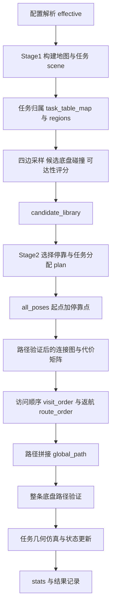

# 场景变化、主流程变量与硕士研究价值核查

核查日期：2026-10-30。基于当前工作树，HEAD 为 `98a403b9ad69508047ada5beabe321047a55c2e8`，分支 `codex/v0.3.0-main-robot-consistency`。工作树包含此前未提交的导航修复，本次保留这些修改，未修改业务算法或默认场景。下述代码位置按本次工作树核查；历史实验单独标明。

本报告回答：改变桌数/角度后能否完成任务、主场景数据如何流动、双臂可达性和路径如何选择，以及这份工作的研究价值。结论是：已实测一个改变桌数和角度的场景能完成当前几何模型下的全部规划；系统具备硕士研究基础，但真实操作可执行性和主创新收益仍需补证。

## 1. 改桌子数量和角度：支持范围与本次实测

### 1.1 配置与运行方式

默认入口 `main_mobile_manipulation_planning.m:15` 调用 `resolve_effective_config()`。默认16张桌、10×10 m地图、0.05 m栅格、桌面尺寸1.2×0.4×0.5 m。`config/scene_config.m:61` 配置桌子中心，`:91` 配置角度。

- `table_mode='custom'` 时，实际桌数取 `size(table_positions,1)`。仅修改 `num_tables` 会被覆盖。
- `table_orientations` 用弧度，建议始终提供与桌数等长的列向量。数量不足补0，不是重复最后一个角度；多余项保留，但不用于前N张桌。
- `random` 模式的局部任务采样，以及相应局部连续采样，会使用 `p_world = center + R(theta)*p_local` 随桌变换。
- `manual_tasks` 是世界坐标。改桌子位置/角度后需要同步重算任务坐标及归属。先由局部点构造的manual配置，后续改角度也不会自动重新构造点。
- 使用C0–C3、L/V命名profile时，profile替换基础场景。有效配置顺序为基础→命名profile→profile_override→experiment_override→user_override，不能只看基础配置文件。
- 未知 `table_mode` 会进入默认6桌分支，应避免模式拼写错误。普通random布局只随机0或π，不等于任意旋转角泛化。

证据：`utils/build_scene_from_cfg.m:101`，`utils/generate_scene_tasks.m:65`，`config/resolve_effective_config.m:16`。

本次使用临时配置进行测试，没有永久改变默认场景：

```matlab
addpath(fullfile(pwd,'pipeline')); init_paths(pwd);
addpath(fullfile(pwd,'experiment_manager'));
s = struct('table_positions',[2 2;5 2;2 5;5 5], ...
    'num_tables',4,'table_orientations',deg2rad([0;30;90;-45]), ...
    'random_seed',2026);
cfg = experiment_config_builder('baseline','scene_override',s);
result = run_selected_experiment(cfg,'headless',true, ...
    'render_outputs',false,'save_record',false);
```

### 1.2 实际验证结果

| 验证范围 | 结果 | 可以说明什么 |
|---|---|---|
| 当前工作树，4桌，角度0/30/90/−45°，seed2026完整流程 | OK；9/9任务几何验证，2289候选，6停靠，27.627060257 m含返程 | 至少这一改桌数与角度后的场景能够完成几何任务规划 |
| 上述完整流程底盘路径验证 | 足迹无碰撞、端点匹配、分段连续、拼接一致；2410个SE(2)采样检查 | 当前地图与采样精度下的底盘几何安全；不是全身连续时间安全证明 |
| 上述单次运行耗时 | 13.556510 s | 单次runner墙钟时间，含结果保存；不是多次重复的算法性能结论 |
| 4/8/16桌混合角场景构建 | 数量、任务坐标旋转、布局合法性均通过 | 场景生成支持这些组合；8/16桌变化案例未在本轮跑完整路线 |
| 相关回归测试 | 13 passed，0 failed，0 incomplete | 场景旋转、布局、独立几何模型及执行一致性检查通过；不是全测试集通过 |
| 2026-10-28已有默认16桌原始日志 | 36任务、27停靠、90.581503 m；路径有效、图连通；4个benchmark通过 | 后续导航修复已经恢复默认场景；本轮未重新跑默认16桌全流程 |

本次MATLAB版本为R2022a。完整流程使用默认 `bottom_up`、`convex_astar`、`sparse_knn`、阈值0.30、当前机器人几何及返航约定。

原始证据与复现：

- `tmp/user_assessment_20261030/verification.log`、`verify_scene_and_reachability.m`。
- `tmp/user_assessment_20261030/rotated_four_tables/pipeline.log:119`、`baseline_record.mat`、`assessment_result.mat`。
- `tmp/user_assessment_20261030/verify_rotated_four_table_pipeline.m`。
- `results/logs/main_scene_repair_20261028/main_scene_repair_summary.log:1`。

完整流程日志前8行保留了验证脚本首次遗漏experiment_manager路径的启动错误；补齐临时脚本路径后成功重跑。该错误不属于规划失败，也未修改业务代码。

### 1.3 为什么不能保证任意布局成功

改变桌角会改变通道、靠近桌边的候选位置、底盘旋转空间和任务相对于左右安装座的位置。桌体不重叠并不代表底盘可通行，更不代表所有任务都存在被采样到的停靠位姿。

默认布局检查的最小通道宽度由 `max(table_min_spacing_m-hypot(L,W),0)` 推得；本配置该值为0，因此仅通过布局检查不能用来证明机器人具有足够通道。候选还受有限位置/朝向采样、地图分辨率及评分阈值影响。规划失败既可能是环境确实不可行，也可能是搜索/采样没找到，必须区分。

改变布局后应重算：

`scene_cfg → grid_map/tasks → task_table_map/regions → candidate_library → plan → 路径代价图/访问顺序 → global_path → 路径与任务验证`。

候选库和路径缓存都有配置/地图签名，但签名不能代替重建派生数据。不要只改 `scene.scene_cfg.table_orientations` 却保留旧地图、任务和候选。

“运行前换布局后重规划”与“执行到一半搬桌后继续剩余任务”不同。`replanning/apply_dynamic_event.m:24` 当前实现新增障碍、停靠失效、新增任务、任务覆盖失败四种事件，没有MOVE_TABLE/ROTATE_TABLE事件；执行中搬桌需要补充任务跟随变换、已完成任务身份保持、受影响区域和缓存失效机制。

## 2. 主场景框架与变量传递



### 2.1 配置和数据契约

世界/底盘坐标采用米与弧度，底盘局部+x向前、+y向左，yaw逆时针。地图行列索引通过world2grid/grid2world转换，不应直接把世界y作为矩阵行号。

| 变量 | 结构/维度 | 生产者→消费者 | 状态如何变化 |
|---|---|---|---|
| `effective` | scene/robot/planner等组件struct | resolve_effective_config→stage1 | 合并覆盖层，校验统一机器人参数 |
| `scene_cfg` | 桌子中心N×2、角度N×1、尺寸、任务规则、采样参数 | 配置→build_scene_from_cfg | 解析实际桌数，生成/验证布局，记录实际任务数 |
| `robot_cfg` | 底盘足迹、安装座偏置、臂几何包络等 | robot_config→候选/可达/路径验证 | 主流程保持固定，同时传入planner_cfg.robot_cfg |
| `planner_cfg` | 阈值、权重、策略、路由与执行参数 | 配置→所有规划层 | 本次默认nominal、0.30、bottom_up、convex_astar、sparse_knn |
| `scene` | grid_map、map_info、tasks、start_pose、num_tasks、scene_cfg | build_scene_from_cfg→后续各层 | 几何构建完成后固定；仿真阶段更新任务status |
| `scene.tasks(tid)` | id/table_id/x/y/z/status等 | generate_scene_tasks→可达性/执行 | 点目标只指定xyz；完成几何验证后status置1 |
| `task_table_map{t}` | 全局任务ID数组 | assign_tasks_to_tables→build_task_regions | 按桌子归组，空桌不建立任务区域 |
| `regions(ri)` | table_id、task_ids、center、radius等 | build_task_regions→候选生成 | 区域索引ri与table_id不一定相等，空桌会造成差异 |
| `candidate_library.regions(ri).candidates(ci)` | pose、covered_tasks、reach_scores、arm_assignment、cost等 | build_candidate_library→三种停靠策略 | 为每区域生成一次；可选增补默认关闭；有场景签名 |
| `reach_scores` | 区域任务数×3 | 双臂评分→候选打分/选择 | 行按region.task_ids排列，列为left/right/combined |
| `covered_tasks` | 全局任务ID集合 | 候选评分→选择器 | 名义模式为综合得分>0的任务；robust模式语义不同 |
| `remaining_tasks` | 当前区域待覆盖ID集合 | select_multi_poses局部变量 | 每次选中候选后减去新覆盖任务，直到空或无可用候选 |
| `plan.selected_poses` / `optimal_poses` | K×3，[x y yaw] | Stage2→Stage3 | 保存选中停靠；名称optimal不表示全局最优 |
| `pose_to_region_map` | K个区域索引 | 停靠结果汇总→稀疏图 | 与selected_poses逐行对应 |
| `task_sequence_summary{k}` | pose/table_id/dock_index/covered_tasks/arm_assign_map等 | append_region_plan→执行 | 保存分配给第k停靠的任务；不是关节轨迹 |
| `pose_info_list{k}` | 覆盖、代价、服务配置等 | append_region_plan→导出/统计/执行 | 与第k个停靠保持对齐 |
| `all_poses` | (K+1)×3 | Stage3 | 第1行为起点，第k+1行为第k停靠 |
| `dist_matrix` | (K+1)×(K+1) | dense路径查询或sparse图最短路→访问排序 | 不可达代价Inf；稀疏图代价可经中间节点 |
| `visit_order` / `route_order` | all_poses行索引 | 策略优先顺序或最近邻→拼接 | route_order默认在末尾追加1返回起点 |
| `global_path` | 当前返回为M×3 SE(2)路径点 | stitch→整路验证/可视化 | 合并实际有效边路径，包含精确端点和朝向 |
| `predicted/commanded/executed/verified_tasks` | 四类任务ID集合 | Stage3与仿真执行器→stats | 预测覆盖→发出指令→模拟报告→几何复核通过，不能混作实机完成 |
| `stats` | 路径、执行、时间、图及验证结果 | Stage3→报告/benchmark | 规划时间与估计执行时间分开；IK与实测完成未知 |

关键位置：`main_mobile_manipulation_planning.m:15`、`pipeline/stage1_build_scene.m:49`、`planning_strategy/common/build_candidate_library.m:13`、`pipeline/stage2_docking_planning.m:14`、`pipeline/stage3_global_planning.m:51`。

### 2.2 候选的生成与选择

每张有任务的桌子，先在局部四边采样。默认中心距桌边0.25–0.40 m、法向步长0.05 m、沿边步长0.15 m。位置与法向按桌角旋转；朝向由任务质心、各具体任务、桌中心和桌边法向产生，再加约±30°范围内的15°偏移并去重。

每个候选先检查旋转矩形底盘与地图的碰撞，再逐任务算左右臂分数。`compute_reachability_field` 的名称不意味着生成了关节空间可达图；它在这里主要生成待评估的停靠姿态。

局部候选成本为6项加权和，默认权重为：可达性0.25、覆盖0.20、朝向0.12、安全间隙0.08、接近距离0.20、机动/换边偏好0.15。其含义是人工设计的多指标成本，不是由真实操作时间拟合出的概率或动力学代价。

默认Bottom-up贪心评分为：

`S(c)=0.35×新增覆盖比例+0.25×新任务平均可达分−0.20×局部成本−0.10×区域内移动成本−0.10×换边惩罚`。

每轮挑分数最高的候选，将它覆盖的尚未分配任务绑定给该停靠，然后更新remaining_tasks。没有新覆盖则停止。所有区域合并后，若全局覆盖不足，Stage2标记 `BLOCKED/PARTIAL_TASK_COVERAGE`，主入口不继续Stage3。

证据：`docking/compute_reachability_field.m:13`、`docking/generate_docking_candidates.m:42`、`docking/evaluate_docking_candidate.m:14`、`docking/select_multi_poses.m:94`、`planning_strategy/common/compute_bottom_up_selection_score.m:1`。

## 3. 双臂可达性：计算、验证与物理边界

### 3.1 当前确切模型

底盘长宽0.423×0.366 m，双臂安装座间距b=0.250 m，安装座前偏mx=0.2115 m，安装高度mz=0.1833 m。

对底盘q=(x,y,θ)与任务点p=(px,py,pz)，分别计算左右臂：

`a_xy = [x;y] + R(θ)[mx; ±b/2]`

`[u;v] = R(-θ)(p_xy-a_xy), w=pz-mz, ρ=sqrt(u²+v²)`。

硬约束为：

- 0.01≤ρ≤0.278 m；
- −0.142≤w≤0.334 m；
- u≥−0.197 m；
- |v|≤1.1×0.278 m。

这是水平半径、高度和方向分别约束的包络。并未根据所有关节角、关节限位与末端姿态求IK。

通过后计算：

`s_dist=1−ρ/Rmax`

`s_center=max(0,1−|ρ−(Rmin+Rmax)/2|/((Rmax−Rmin)/2))`

`s_z=max(0,1−|w−(zmin+zmax)/2|/((zmax−zmin)/2))`

`s_forward=clip(u/reach_forward,0,1)`

`s=clip(0.30s_dist+0.25s_center+0.20s_z+0.15s_forward+0.10(1−|v|/reach_lateral),0,1)`。

若s<0.30返回0，否则保留s。该分数是启发式质量指标，不是成功概率，也不是雅可比可操作度。桌面0.5 m对应w=0.3167 m，已接近配置高度上界，这也是高度项可能较低的原因。

双臂综合值为 `s_dual=max(s_left,s_right)`。分数高的臂承担任务，平分选左臂，两者都为0则none。其语义是“至少一只臂可操作该点”，不是“两只臂同时协调完成该任务”。

证据：`config/robot_config.m:9`、`manipulator/evaluate_single_arm_reachability.m:9`、`manipulator/evaluate_dual_arm_reachability.m:6`。

### 3.2 验证分层

| 验证 | 当前实现 | 不能由此推出 |
|---|---|---|
| 候选底盘碰撞 | 旋转矩形与障碍栅格检查 | 机械臂连杆无碰撞 |
| 底盘全路径 | SE(2)插值采样、足迹、端点、拼接检查 | 连续时间全身碰撞安全、非完整运动学与动态可执行性 |
| 独立几何模型 | independent_geometric_reachability用独立公式实现交叉核对 | 包络一定等于真实机器人关节可达域 |
| 任务仿真verified | simulate_planned_task_execution再次调用同一生产可达函数 | 独立物理验证或实机成功 |
| IK接口 | evaluate_ik_feasibility无adapter时NotImplemented | 已求出合法关节解 |
| 关节运动、姿态约束、手臂环境碰撞、自碰撞、双臂互碰 | 当前主链未验证 | 双臂协调操作已完成 |

`executed_tasks=commanded_tasks` 是仿真器中的赋值。通过几何复核的任务才进入verified，并由 `execution/update_task_state.m:4` 将status置1。证据中IK/实测完成应保持NaN，不应改成0或100%。

配置中虽有DH和关节限位字段，但主可达性评估不使用它们求解运动学；d1只参与安装高度。另有evaluate_bimanual_reachability接口，但未接入主链，且仍非碰撞感知的双臂协调规划。

### 3.3 可选鲁棒与升降分支

默认 `reachability.mode='nominal'`。robust模式枚举5个位置偏移与3个yaw偏移，共15种组合，统计几何接受比例，默认要求全部接受。误差模型为配置边界、`measured=false`，不是实测概率模型。

每个扰动重新取max(left,right)，而导出的arm_assignment仍来自名义姿态。因此目前不证明固定分配臂在所有扰动下可用，也未检查扰动后的底盘/机械臂碰撞。

升降默认关闭。现有expand_lift_candidates主要复制服务配置并填写高度，主评分仍使用固定arm_base_mount_z；不能称为底盘–升降–双臂联合优化。

## 4. 后续路径如何选出来

### 4.1 三种策略与默认行为

| 策略 | 工作顺序 | 当前边界 |
|---|---|---|
| bottom_up，默认 | 各桌贪心选择停靠，再安排全局访问 | 局部选点可能给后续路线造成额外绕行 |
| top_down | 先选区域锚点和区域顺序，再考虑路线选停靠，并做覆盖修复 | 仍受候选库、锚点预算和启发式限制 |
| bidirectional | Bottom-up为初值，尝试删冗余停靠、替换、二合一、路线调整 | 有限轮局部搜索，不保证全局最优；现实现还有早停风险 |

Bidirectional目标函数包含未覆盖任务数、停靠数、路线长度、局部成本和估计执行时间；搜索中传入的估计执行时间为0，因此不能把该搜索称为已完整优化真实总执行时间。

### 4.2 Stage3的具体选择

1. `all_poses=[scene.start_pose;optimal_poses]`。
2. 默认sparse_knn：按空间近邻、同区域/跨区域规则挑潜在边，对每条边调用真实路径规划器。验证失败的边丢弃；不连通时尝试跨分量桥接，仍失败则报SparseGraphDisconnected。
3. 对有效边图求最短路代价与next_hop。图最短路可经过其他停靠节点，图上的连线不等于机器人直线穿行。
4. 若策略提供合法preferred_visit_order则采用；否则从起点按最小剩余代价做最近邻访问。默认enable_2opt=false，可选2-opt仍是启发式。
5. 默认末尾追加起点1。根据实际边路径或图中间节点拼接global_path，并验证完整路线。
6. 仅通过路径验证后才进入任务仿真和时间估计。stage4随后做多算法benchmark，不会从benchmark中自动挑一条路线替换主路线。

默认路径规划器为convex_astar。`run_path_planner`先在足迹保守膨胀地图搜索，校验并连接精确停靠端点；失败时可能使用A*回退，并在满足条件时尝试固定朝向矩形配置空间的A*恢复。每次恢复仍需通过原始安全膨胀scene地图上的矩形足迹检查。

固定朝向恢复是一种有限的全向底盘恢复方式，并非完整SE(2)搜索，也没有替代速度/加速度/非完整约束验证。稀疏图将边路径反转复用，依赖当前静态几何与可逆运动假设；改为差速/单向运动代价时需要重新设计。

dense模式显式采用路径长度加 `0.15×|wrap(Δyaw)|`；当前sparse边成本直接来自路径查询长度，不能把dense公式一概当作所有路由模式的代价。

证据：`pipeline/stage3_global_planning.m:51`、`:62`、`:87`、`:100`、`:119`，`global_planner/build_sparse_docking_graph.m:17`，`global_planner/compute_path_cost_matrix.m:17`，`global_planner/run_path_planner.m:63`、`:98`。

### 4.3 需要优先核实的双向搜索问题

`plan_bidirectional.m` 中的best_neighbor按操作顺序返回第一个生成候选，没有遍历比较所有改进；remove_dock删掉位姿和任务摘要后未同步更新covered_tasks_predicted，try_redundant_removal紧接着使用的覆盖仍旧。外层刷新后会检查真实覆盖，但一旦下降或目标未改善就退出迭代，可能跳过后续有效替换。

这说明存在过早停止/漏搜风险，不意味着最终覆盖门禁完全失效。本次未修复这一实现，也未专门运行邻域反例测试。若将双向耦合作为论文主创新，应优先构造“第一个邻居无效、后续邻居有益”的测试并修复，再重做策略对比。

## 5. 硕士研究价值与创新性判断

独立评审：`claim_supported=partial`，`confidence=medium`。无paper/PAPER_CLAIM_AUDIT.json，属于provisional判断。这里是研究充分性评估，学校与导师的具体毕业标准不在现有材料中。

### 5.1 已有成果支持什么

工作已有明确任务问题、参数化场景、可达性筛选、集合覆盖式停靠选择、路线连接、安全验证、实验日志和失败诊断，具备硕士研究的系统基础。它能服务于“多区域操作任务应该在哪里停、覆盖哪些点、以何顺序到达”的高层决策。

| 原始证据 | 观察 | 可支持的范围 |
|---|---|---|
| 本轮4桌完整流程与10/28默认16桌日志 | 修改布局案例与默认案例分别完成几何规划 | 特定案例可用，不是任意布局成功 |
| results/tables/position_only_heldout_coverage_raw.csv | 旧配置保留种子6–20，15/15候选覆盖恢复到100% | 该生成器下补充候选能修复采样缺口，不是当前实机完成证据 |
| results/tables/position_only_resource_bounded_four_mode_summary.csv | 旧配置Position OFF/ON平均562.334/151.363 s | 旧批次内缓存有计算复用收益，不能混作最新版本实测性能 |
| results/tables/strategy_comparison_summary.csv | Bottom-up/Bidirectional均27停靠、63.2948 m；55.03/212.18 s；接受改动0 | 该历史案例未显示双向方案路线收益；当前需重新测，不能宣称已普遍优于Bottom-up |
| 10/27 evidence包dynamic/dynamic_raw.csv | 9个事件对子，Local成功5/9，Full成功6/9 | 局部修复部分有效；失败后转全量的成本仍需计入 |
| 10/27 evidence包complex/complex_raw.csv | C0/C1各3成功；C2覆盖72.31–78.95%；C3两成功一导航阻塞 | 保留失败边界；10/28导航修复后未全部重跑，不作当前全面结论 |

9月策略的63.29 m与10月当前90.58 m来自不同安全/实现条件，不能直接比较为方法变差或变好。最新与历史证据必须按代码、机器人、阈值、地图安全、返航和计时范围分组。

### 5.2 与已有和近期研究的关系

下表仅作能力与问题定位，没有在共同实验设置上复现这些论文，因此不作直接性能排名。文献于2026-10-30查询作者/机构论文页与arXiv主来源。

| 研究 | 已研究的关键问题 | 对当前工作定位的影响 |
|---|---|---|
| Reister等，RA-L 2022，Combining Navigation and Manipulation Costs | 联合底盘停靠、抓取/选臂、导航与操作成本，并含实机演示 | “考虑导航与操作成本耦合”不是新的首次贡献。[机构论文页](https://publikationen.bibliothek.kit.edu/1000149803) |
| MoMa-Pos，2024论文版本 | 逆可达图、对象运动学、任务相关环境建模与底盘位置优化 | 应与强的可达图/基座放置基线比较。[论文](https://arxiv.org/abs/2403.19940) |
| Integration of Robot and Scene Kinematics for SMMP，2025 | 场景/机器人运动学统一、长序列任务与全身运动、实机验证 | 当前二维底盘路线加点可达性没有实现该能力范围。[论文](https://arxiv.org/abs/2508.18627) |
| Dual-Arm Whole-Body Motion Planning，Humanoids 2025 | 利用双臂共享关节结构组合动态路图，并在实机验证 | 左右评分取max不等价于双臂全身运动规划。[论文](https://arxiv.org/abs/2511.08778) |
| cuRoboV2，2026技术报告 | 高自由度动力学约束轨迹、深度融合距离场和自碰撞计算 | 可作为后续运动可执行性后端的参考；与高层多停靠规划不是同一层任务。[技术报告](https://arxiv.org/abs/2603.05493) |
| DockAnywhere，2026，作者页面标明RA-L接收 | 不同停靠点下操作策略的视角泛化与示范生成 | 停靠变化仍是有价值的问题；可以研究高层停靠质量如何影响下游技能。[论文](https://arxiv.org/abs/2604.15023) |

判断：硕士研究方向合适，完整论文证据仍需补齐；现阶段强项是高层几何规划及工程可验证性，算法原创性证据偏弱。分层、加权评分、贪心覆盖、A*和缓存均为成熟组件，模块数量不能代替独立方法贡献。无需为了前沿标签强行转向VLA/RL；更有用的是明确自己解决下游操作系统的哪一个瓶颈，并用可比实验说明。

建议题目/主张范围：**面向多区域桌面任务的覆盖约束停靠选择与移动路径规划**。如果保留“双臂”，应说明平台与任务分配语义；只有补齐协同运动证据后再使用“双臂协调操作”主张。

### 5.3 建议优先完成的研究闭环

1. **独立操作可执行性。** 完整机器人模型、末端目标姿态、多初值IK、关节限位、臂–环境/双臂/自碰撞、停靠内任务间连续轨迹。先把几何模型当快速预筛，统计对独立求解器的假阳性和漏检；有限IK失败也不直接证明不可达。
2. **确定一个可检验的核心贡献。** 优先在覆盖缺口驱动的候选增补与覆盖保持的停靠–路线优化之间选主线。若选后者，先处理早停/状态刷新问题，给出单向选择绕行而耦合优化改善的明确场景。
3. **冻结当前版本做泛化矩阵。** 桌数、角度、间距/窄通道、任务距桌边位置联合变化；开发种子与保留测试分开。分别记录候选覆盖、完整计划成功、IK/运动成功、实机成功，不能只报覆盖。
4. **公平基线。** 同一任务集、机器人、可达阈值、候选预算、安全模型和返航规则，比较Bottom-up、Top-down、修复后的Bidirectional及强联合优化/可达图基线。小规模可用精确离散求解或高预算参考测量差距。覆盖不等的短路径不能当质量优势。
5. **诚实统计动态恢复。** 将失败纳入成功率；只有双方成功的对子才比较成功重规划耗时，另报告失败后全量回退的端到端总成本。当前未实现的桌子移动/旋转事件如要成为研究内容，需单独建模与验证。

本次完成审查、已有证据核对、13项相关测试与一个变化布局的全流程验证；没有开展全布局扫参、双向算法修复或实机实验。独立评审原文和结构化结论见 `paper/review-traces/experiment-result-to-claim/2026-10-30_run01/`。
