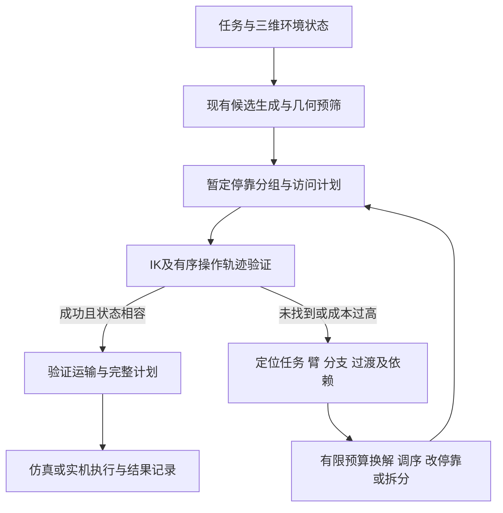

# 硕士论文研究规划：复杂任务中移动平台与机械臂的协同规划研究

日期：2026-10-30（Asia/Shanghai）。类型：硕士学位论文研究与实施规划，不是投稿稿件或已完成成果声明。学校格式、篇幅、机器人型号/模型文件和实际截止日期尚未确定；不采用技能默认ICLR篇幅。章节数：6。计划中的新方法与性能主张均标为待实现、待实验。

规划依据：当前工作树、`docs/SCENE_PIPELINE_RESEARCH_REVIEW_20261030.md`、已保存的独立评审、截至2026-10-30可访问的一手文献。现有业务文件及先前未提交修改均保留。本次只形成规划文档，不调整机器人参数或启动算法重构。

## 1. 直接判断与研究边界

题目可以保留。现有代码已经覆盖“面向操作任务的底盘停靠和导航”，但“复杂任务”主要表现为任务点/工作台数量，“机械臂”主要提供几何评分；真正的动作状态、关节轨迹以及机械臂对停靠决策的反馈较弱。继续增加桌数、A*变体或调权重，难以弥补这两个缺口。

推荐研究主线：**面向多工作区域短序列操作任务，研究操作序列可执行性约束下的停靠分组、停靠选择与访问规划，并利用运动验证结果修复候选计划。**

这里将“协同规划”明确限定为分阶段执行下的联合决策：平台位姿决定操作可行性与成本，机械臂的动作约束反过来改变平台位置、任务分组和访问顺序。底盘移动时机械臂处于已验证的运输姿态，操作时底盘静止。该范围不声称连续全身同步运动控制。

题目没有要求两只机械臂同时工作。先建立一只臂的完整可执行闭环；另一只臂在第一阶段保持固定姿态但仍计入碰撞模型。之后可增加左右臂独立任务分配，最后才考虑双臂协作搬同一物体。

### 最小场景定义

- 已知或人工标注的环境几何、目标位置和类别；使用桌面、支撑、墙体、简单障碍的3D碰撞模型。
- 2–4个工作台为主实验，8桌扩展作为选做；每站完成短序列的定向触达或站内取放。
- 取放仅使用1–2类已知抓取模板/工具动作；目标区域预先给定。动作包含接近、操作、退离与必要的任务前后状态。
- 复杂性来自空间限制、操作方向、动作先后依赖、夹持/容量和放置后的环境变化，选择其中2–3项形成可解释任务。不能仅以“桌子多”定义复杂。
- 基础方案站间空载移动；站内取放会更新被抓物体的附着状态和放置位置。跨站持物、精细接触动力学、抓取合成、视觉识别和开放语言指令不作为基础交付。
- 当前配置列出5个关节限位，但实机自由度尚未确认。若为5自由度，不给所有任务强加任意6D末端姿态；按技能使用位置+接近轴/允许绕轴旋转的约束，并报告容差。

这些限制使研究集中在规划问题，同时保留与真实操作相连接的检验方式。

## 2. 问题定义锁定

| 问题 | 具体失效现象 | 与题目的关系 | 计划解决方式 | 必要证据 |
|---|---|---|---|---|
| P1：停靠覆盖不等于操作可执行 | 几何评分接受，但目标姿态无合法IK、当前关节状态无法连到目标、操作路径碰撞 | 让机械臂进入规划约束，而非仅作为底盘的评分函数 | 几何提案→IK见证→完整局部动作轨迹验证，分开记录证据层级 | FK/IK与碰撞校核；几何误判与运动失败分类；完整动作链验证 |
| P2：逐点规划忽略序列与跨停靠代价 | 每次只看新增覆盖或当前目标，可能产生高代价退避、多次停靠，或未考虑操作后的场景状态 | 平台位姿、操作顺序与任务分组需要相互影响 | 对有序服务片段进行验证，将失败/成本反馈给分组、位姿与路线局部修改 | 同模型、同预算的逐点IK基线、通用惰性反馈基线及删除对照 |
| P3：变化后重复验证过多（支持性、选做） | 一个局部障碍/目标变化引发全量重算，或旧证据错误复用 | 检验协同计划的执行适应性 | 以验证依赖和场景版本确定哪些片段失效，重验后局部修复 | 全量重算对照；变化外片段复用正确性；失败与回退总成本 |

P1与P2是必须完成的主线。P3只有主线通过机制验证后才开展；若时间不足，在第5章作为局限与小规模扩展，不单独包装成完整的在线TAMP方法。

### 关键逻辑边界

“每个目标有IK”不保证从当前状态存在无碰撞运动。但在静态空载环境中，如果每个目标都已验证从同一q_home出发且可逆返回，则可以经q_home串联这些目标，不能再声称序列必然不可执行。

因此实验必须区分：点IK未验证连接、物体状态改变、方向/先后约束、以及可行但代价高的连续过渡。返回home应作为同安全模型下的强救援对照。某个IK分支或某次采样规划失败不能证明所有分支都失败；拆分任务但保持相同基座与环境也不会自动创造可行性。

## 3. 创新定位与已有工作

以下是研究定位，不是共同基准上的性能排名。核心机制的新颖性仍需进一步精读和实验验证；不能承诺已有顶会级原创性。

| 一手来源 | 已覆盖的内容 | 当前方案应避免的过度主张 |
|---|---|---|
| [Reister、Grotz、Asfour，RA-L 2022](https://publikationen.bibliothek.kit.edu/1000149803) | 联合导航/操作成本、底盘停靠与抓取/选臂 | 不能称首次考虑导航与操作耦合 |
| [PDDLStream，ICAPS 2020](https://ojs.aaai.org/index.php/ICAPS/article/view/6739) | 黑盒连续采样与符号计划的组合 | 两层规划、调用IK和按需几何检查不是独立新颖点 |
| [LAZY，ICRA 2023](https://arxiv.org/abs/2210.14055) | 带反馈的惰性任务与运动搜索 | 反馈/惰性验证本身不是新贡献 |
| [R-LGP，2024修订版](https://arxiv.org/abs/2310.02791) | 可达图引导逻辑几何规划与完整路径优化 | 不能笼统声称首次用可达性约束任务序列 |
| [BaSeNet，IROS 2024](https://arxiv.org/abs/2406.08653) | 学习多目标抓取的基座位姿序列与导航/抓取成本 | 多停靠、访问顺序或采用学习方法都不是自动成立的创新 |
| [COAST，2024论文](https://arxiv.org/abs/2405.08572) | 约束与stream结合的TAMP | 失败约束回传并非空白问题 |
| [MoManipVLA，CVPR 2025](https://arxiv.org/abs/2503.13446) | 通过双层运动优化使固定基座VLA产生的操作轨迹在移动平台上可行 | 学习方法与几何规划可以结合；不应笼统说学习方法不处理可行性 |
| [SMMP，2025版本](https://arxiv.org/abs/2508.18627) | 机器人与场景运动学结合，长序列及全身运动 | 基础方案不覆盖铰接物体、全身动态控制等范围 |
| [SC-BPE，作者预印本项目页](https://qihangli.com/sc-bpe/) | 对完整动作骨架与一个固定底盘位姿联合评分、后续由TAMP细化 | 不能称首次考虑序列级停靠质量；应强调有限预算下跨多个停靠的分组/修复机制 |
| [cuRoboV2，2026技术报告](https://arxiv.org/abs/2603.05493) | 高自由度动力学约束运动生成与碰撞计算 | 可借鉴为低层后端；不需要在硕士周期内重新实现同等全身规划器 |

来源状态核验说明：检索遇到的ANCHOR（arXiv:2604.25323）当前页面明确标记2026-09-17撤回，故不采用其性能结论或作为已验证前沿基线。SC-BPE仅按作者页预印本定位，未假定正式会议/期刊接收。

### 拟议方法贡献

**候选主贡献：操作序列可执行性反馈驱动的多停靠任务分组与协同修复。**

差异应落实到一个可复现机制：验证记录指向具体的任务–臂–位姿、IK分支或操作过渡；搜索在有限预算下尝试同位姿调整、任务重排、移动停靠或拆分分组，并只复用条件仍成立的证据。对比的通用lazy基线必须获得相同任务状态、相同验证器、相同候选上限和采样机会，不能把更强碰撞模型的收益归功于新搜索。

补充IK、增加schema、修复bug属于必要基础工作。缓存和稀疏图作为效率支撑。三个论文章节不等于必须提出三项互不相关的新算法。

## 4. 主张—证据矩阵

| 主张 | 现有证据 | 状态 | 将用何种实验验证 | 章节 |
|---|---|---|---|---|
| 现有高层几何规划可处理部分桌数/角度变化 | 4桌混合角9/9几何接受、13测试；已有16桌修复日志 | 已有但仅几何层 | 保留为回归，不冒充新方法物理实验 | 2、5 |
| C1：固定规划墙钟预算内，序列验证反馈提高完整可执行计划成功率 | 尚无真实IK/轨迹后端或新方法结果 | 研究假设，needs experiment | 三类基线、30保留场景、相同验证器/预算；完整成功为唯一预定主指标 | 3、4、5 |
| C2：在相同验证标准下，复用未受影响片段降低变化后的验证开销 | 当前只有几何动态修复的部分证据 | 支持性假设、选做 | 局部事件与全量重算配对，包含失败和回退耗时 | 5 |
| 真正双臂协调、连续全身控制、SOTA优势 | 无 | 不主张 | 不列入基础论文任务 | 局限 |

C1的次要指标包括总体规划耗时、有效计划的执行时间估计/测量、停靠数、机械臂运动量和底层调用量。不能在正式保留集上看到哪个指标有改善后再更换主指标。若开发集出现成功率天花板，须在保留集运行前记录主张修改，例如改为相同完整成功条件下的任务执行成本；原计划与修改原因保留。

## 5. 方法与数据契约

### 5.1 从点任务到动作任务

任务输入拟增加：`object_id`、`skill_id`、目标区域/位置、方向约束与容差、接近/退离参数、允许机械臂、`predecessor_ids`、前置条件与状态变化。仅在任务真实需要时添加先后关系，不能用任意依赖人为制造优势。

任务点优先存桌子局部坐标并由场景变换生成世界坐标。对象状态包含当前位姿、是否被夹持、附着到哪只臂、是否已放置；同一验证器对允许接触的设置一致。纯定向触达实验可以不引入抓取动力学，但不能用其结果推断抓取成功。

### 5.2 操作可执行性分层

几何评分用于候选提案/排序。未校准的启发式阈值不能被当成可靠物理硬拒绝条件；保留被其拒绝样本的审计与必要补采样。完整后端输出包括：合法IK见证、FK残差、关节限位、环境/自碰撞、接近/操作/退离/任务间过渡轨迹与版本。

状态至少区分 `UNTESTED`、`IK_VALID`、`IK_NOT_FOUND`、`MOTION_VALID`、`MOTION_NOT_FOUND`、`TIMEOUT`、`MODEL_INVALID`、`EXECUTION_FAILED`。`NOT_FOUND/TIMEOUT`只表示预算内未找到，不能永久排除对应连续位姿空间。缓存失败需要绑定求解预算/种子并允许升级验证。

### 5.3 服务片段与连接

一个服务片段表示为：

`service = (base_pose, ordered_actions, assigned_arms, q_in, q_out, state_in, state_out, motion_segments, cost, validation_record)`。

它必须有连续的关节状态与对象状态。不能对每个目标独立求IK后直接把解数组拼成“轨迹”。同一站内先尝试直接过渡，也允许经安全姿态退避；跨停靠边界采用有限集合中的已验证运输姿态以限制组合规模。

即使空载收臂，移动层也不能仅检查0.423×0.366 m底盘矩形：需要根据完整机器人在运输姿态下的形状校核扫掠碰撞，或用已核实的保守投影包络。若持物运输加入扩展，连同物体外形、附着变换一起验证，并进入缓存键。

### 5.4 规划与修复流程

基准目标是在全部必需动作/前置条件/碰撞/衔接约束通过时输出成功，不能用一个很大的未覆盖惩罚代替成功门禁。成功计划中可比较导航、对准、操作、退避之和。若只有常速近似，明确报告“估计执行时间”；用真实轨迹时间参数化/实测日志替换后才能作为实际任务效率。

修复次序是待验证的策略：先以明确预算尝试不同IK分支/允许臂/同站顺序，再比较局部位姿替换或分组拆分，必要时扩大路线调整。不能对每个高价邻居无限求解，也不能遇到第一个无效邻居就停止全搜索。

## 6. 代码调整清单

| 优先级 | 当前文件/目录 | 调整 | 完成标准 |
|---|---|---|---|
| 保留 | environment、compute_reachability_field、global_planner、日志/实验管理 | 作为场景、候选提案、导航与实验骨架 | 原基线可复现，新模式不暗改旧参数 |
| P0 | config/robot_config.m及外部模型资产 | 核对完整关节链、轴方向、零位、工具坐标、碰撞体；模型版本化 | FK与已知姿态一致，模型来源明确；不靠更换臂长让实验通过 |
| P0 | utils/generate_scene_tasks.m、任务标准化/场景schema | 添加目标方向、技能、依赖、对象状态及局部坐标 | 不可把握的过约束任务能明确诊断；任务状态可回放 |
| P0 | manipulator/evaluate_ik_feasibility.m | 接真实后端，返回q解、残差、状态和预算 | 独立FK/碰撞复核通过，未配置不返回成功 |
| P0 | 新增局部操作序列验证器；collision/validate_service_config_collision.m | 从底盘碰撞扩展到操作动作链的完整碰撞与连续性 | q_out→q_in连续，物体状态正确传播，过渡均有证据 |
| P0 | docking/build_service_config.m、append_region_plan.m、integration/schemas及validate_mission_plan.m | 保存轨迹引用/输入输出状态/版本；严格验证枚举和字段 | 当前dual_independent输出与schema枚举不一致的问题有回归用例；旧文件可识别 |
| P1 | plan_bidirectional.m及新策略入口 | 修复旧覆盖刷新和早停，再加操作反馈的邻域搜索 | 第一个无效邻居不阻止后续有效改进；最终计划重新完整验证 |
| P1 | build_path_cache_signature及新操作验证缓存 | 加模型、目标约束、关节初态、对象/场景版本、臂与预算 | 场景或状态改变后旧证据不会被错误当有效 |
| P1 | execution/estimate_execution_time.m、仿真与日志 | 分别记录几何、IK、轨迹验证、模拟执行、实测结果 | 不用未验证双臂并行轮次宣称时间收益 |
| P1 | global_planner与运输验证接口 | 保留底盘路径提案，补运输形状下的验证 | 收臂仍突出底盘时能发现碰撞；底盘类型约束一致 |
| P2 | replanning/local_replan.m与apply_dynamic_event.m | 核心完成后再加操作失败/目标变化；研究搬桌时保存任务身份和局部坐标变换 | 局部/全量同初态同事件；失败和回退都有日志 |

不建议同时重写所有规划器、引入升降、训练VLA/RL、实施双臂闭链搬运和连续全身MPC。先把已有高层流程与一种可信操作后端接通，再评估是否需要更复杂组件。

## 7. 三部分研究内容与六章组织

研究内容1：**任务约束下的平台—机械臂操作可执行性建模与验证**。它提供模型与证据基础，不能把“调用IK”单独包装为方法突破。

研究内容2：**操作序列反馈驱动的停靠分组与访问协同规划**。这是主要拟议贡献，围绕一个明确瓶颈设计方法、强基线和消融。

研究内容3：**复杂布局下的系统验证与受控局部恢复**。以共同验证标准衡量完整任务表现；恢复作为主方法的支持性扩展。

| 章 | 目的与内容 | 必须回答的问题 | 计划图表 |
|---|---|---|---|
| 1 绪论 | 工程需求→操作/导航衔接失效→已有工作→P1/P2→拟研究内容 | 为什么当前高层覆盖不能代表协同任务完成？ | 任务与失败机制总览图 |
| 2 系统与问题建模 | 机器人、坐标、几何、任务状态、动作约束、协同范围与统一协议 | 本文中的“复杂”和“协同”具体指什么？ | 状态/接口图；约束与符号表 |
| 3 操作可执行性建模与验证 | 几何预筛、IK见证、序列过渡、运输形状与证据层级 | 规划输出如何被独立检验？ | 几何/IK/轨迹接受差异；误判案例 |
| 4 操作反馈驱动的协同规划 | 服务片段、停靠分组、有限预算邻域、失败记录与复用 | 相对点级或通用lazy，具体改变了哪一步搜索？ | 算法流程；真实模型机制案例；消融 |
| 5 实验与讨论 | 统一基线、主结果、保留布局、复杂性拆解、可选恢复/实机 | 哪些收益成立、成本多大、何时失败？ | 主表、成功随预算曲线、分项成本、失败分类 |
| 6 总结与展望 | 回答P1/P2，列举模型、场景、任务和执行边界 | 证据允许得出什么，哪些仍未实现？ | 不新增未验证结果 |

摘要暂不填写提升百分比。结构为：多区域操作问题与几何覆盖不足→序列验证及反馈规划→待实验的完整成功/成本结果→适用范围。作者、学校格式与页数待后续确定。

### 绪论蓝图

1. 工程需求：多工位服务/物料处理需要协调移动与局部操作。
2. 问题出现：位姿选择影响手臂运动，操作后的状态又影响下一任务，单纯缩短路线不能代表完整任务质量。
3. 方法类别：逆可达图/基座放置、TAMP/优化、学习与规划混合。对每类描述其实际覆盖的能力，避免把所有已有工作当单向启发式。
4. 局限段1：对于本项目采用的几何/点级基线，覆盖与IK终点没有保证完整局部动作链；用机制案例说明。
5. 局限段2：对于本项目评测范围，如何在昂贵运动验证下协调多停靠分组与局部修改，仍需检验特定增量机制的效率。此处不能声称整个研究领域没有序列推理。
6. 方法过渡：提出研究操作序列验证反馈驱动的多停靠协同规划。
7. 贡献：状态/可执行性建模（基础）、具体搜索修复机制（拟议主贡献）、严格统一的验证实验（结果待填）。不在实验前写定优于基线。
8. 组织：按六章递进。

## 8. 图表与引文计划

| 图表 | 内容/对比 | 数据状态 | 重要性 |
|---|---|---|---|
| 图1 主图 | 同一真实模型与任务：点级方案、统一验证发现失败/高成本、反馈改变停靠或分组后的可执行方案；同时画任务状态变化 | 待构造并验证，不能用手工blocked标记代替 | 必需 |
| 图2 模型与状态 | 底盘、臂、对象、动作序列、输入/输出状态与运输姿态 | 模型待提供 | 必需 |
| 图3 算法 | 暂定计划→局部验证→定域反馈→候选修改→完整验证 | 可画方法示意，但不得暗示已实现 | 必需 |
| 表1 模型证据 | 几何接受/IK/轨迹/模拟执行/实测的独立指标 | 待采集 | 必需 |
| 表2 主结果 | 完整成功、所有运行规划时间、成功对子执行成本、停靠数、失败分类 | 待运行 | 必需 |
| 图4 消融 | 同一表示和后端下去序列反馈/去定域修复/加home救援 | 待运行 | 必需 |
| 图5 泛化 | 保留桌角/布局/任务方向与成功-预算曲线 | 待运行 | 必需 |
| 表3 恢复 | 全量/局部成功率、失效证据、复用量、含回退耗时 | 选做 | 支持 |

图1标题草案：“操作验证对停靠规划的反馈作用。三列使用相同机器人、任务、候选预算和验证器，展示点级选择、操作过渡检查以及反馈后计划；颜色分别表示已验证、待验证与本次验证失败，未找到运动不解释为物理不可达。”

引文分配：第1/2章使用Reister、BaSeNet、MoManipVLA、SMMP说明定位；第3章联系逆可达/IK与SC-BPE的序列评价；第4章明确继承PDDLStream、LAZY、COAST、R-LGP已有思想，突出自己的有限差异；第5章只把确实复现且模型/任务兼容的方法称为实验基线。

## 9. 条件性实施进度与决策门槛

以下按2–3个月给出依赖顺序，不代表用户已确认时间或已有模型。首要风险不是算力，而是机器人模型与操作验证后端是否可信。

| 阶段 | 建议时间 | 交付 | 继续条件 |
|---|---|---|---|
| M0 模型与范围 | 第1–2周 | 真实关节链/URDF、碰撞模型、1–2技能、单停靠完整轨迹 | 通过FK/限位/碰撞与状态连续校核；没有模型先解决模型 |
| M1 机制验证 | 第3–4周 | 3个真实模型困难案例+3个普通对照；点级和home救援基线 | 确认操作反馈有独立可解释收益；若没有，修订研究假设，不直接扩跑 |
| M2 主方法 | 第5–6周 | 状态化服务片段、旧搜索bug修复、有限预算定域修改 | 与同后端generic lazy对比，避免只因后端更强而获益 |
| M3 主实验 | 第7–8周 | 冻结协议、保留场景对比及核心消融 | 所有失败纳入统计，主指标事先确定 |
| M4 支持验证 | 第9–10周 | 小扰动/局部事件；若实机可用做有限真实试验 | 不扩大到新机器人、新技能或全身控制 |
| M5 整理 | 第11–12周 | 图表、复现包、论文写作与证据审查 | 所有结论对应代码版本与原始结果 |

只有约1个月：优先模型/可执行性闭环与一种小规模反馈机制，裁掉动态恢复、双臂并行、大规模扫参；不能承诺按现有缺口完成全面创新验证。至少4–6个月：在核心成功后再考虑实机、双臂独立调度、跨站持物或局部底盘—机械臂同步运动中的一项，不同时扩展全部。

## 10. 交叉评审与已采纳修正

独立评审认为该方向与题目更贴合，适合作为聚焦硕士方案；方法原创性仍为待验证增量。完整评审见同目录REVIEW.md。

已采纳：固定C1主指标；以scene为统计单位；相同验证器和补采样机会；加入同状态表示的generic lazy删除对照；明确home可逆连接的逻辑；将跨站持物降为选做；运输验证包含收臂几何；正式扫参前设置6个机制案例门槛；不使用撤回论文的结果；将模型和接口修复列为基础工作。

后续首先落实模型与一个单停靠动作链，再启动方法改动。完整实验设计与执行状态见EXPERIMENT_PLAN.md和EXPERIMENT_TRACKER.md；本规划的新增方法实验均尚未执行。
